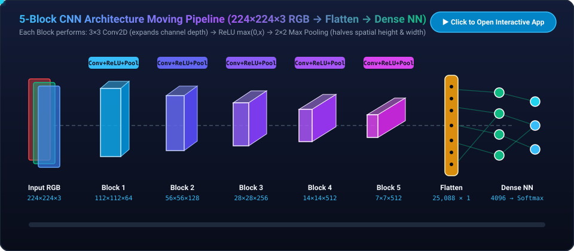

# 5-Block CNN Architecture Moving Animation

### 🚀 [▶ Click Here to Launch the Interactive CNN Animation in Your Browser](https://htmlpreview.github.io/?https://github.com/InodUmayanga/Cognitive-Architectures/blob/main/index.html)

*(Also available on GitHub Pages at [https://inodumayanga.github.io/Cognitive-Architectures/](https://inodumayanga.github.io/Cognitive-Architectures/))*

[](https://htmlpreview.github.io/?https://github.com/InodUmayanga/Cognitive-Architectures/blob/main/index.html)

Interactive HTML5 Canvas web animation illustrating a 5-block Convolutional Neural Network (CNN) starting from a `224×224×3` RGB image through Convolution (`3×3`), ReLU activation (`max(0, x)`), `2×2` Max Pooling (stride 2), Flattening (`25,088×1`), and a Dense Neural Network (`4096 → 4096 → 1000` Softmax).

## Features

- **3D Feature Volume Pipeline**: Interactive isometric view showing spatial dimensions halving (`224 → 112 → 56 → 28 → 14 → 7`) while channel depth expands (`3 → 64 → 128 → 256 → 512 → 512`).
- **Live Micro-Operation View**: Real-time step-by-step visualization of sliding `3×3` convolution filters, in-place ReLU thresholding, `2×2` max pooling windows, 3D-to-1D tensor flattening, and multi-layer perceptron signal propagation.
- **Interactive Playback Controls**: Play/Pause, Previous/Next sub-step navigation, adjustable animation speed (`0.4×` to `2.5×`), and direct stage selection pills.

## Architecture Progression

| Stage | Operations | Input Tensor | Output Tensor |
| :--- | :--- | :--- | :--- |
| **Input** | RGB Channel Split | `224 × 224 × 3` | `224 × 224 × 3` |
| **Block 1** | `3×3` Conv2D → ReLU → `2×2` MaxPool | `224 × 224 × 3` | `112 × 112 × 64` |
| **Block 2** | `3×3` Conv2D → ReLU → `2×2` MaxPool | `112 × 112 × 64` | `56 × 56 × 128` |
| **Block 3** | `3×3` Conv2D → ReLU → `2×2` MaxPool | `56 × 56 × 128` | `28 × 28 × 256` |
| **Block 4** | `3×3` Conv2D → ReLU → `2×2` MaxPool | `28 × 28 × 256` | `14 × 14 × 512` |
| **Block 5** | `3×3` Conv2D → ReLU → `2×2` MaxPool | `14 × 14 × 512` | `7 × 7 × 512` |
| **Flatten** | 3D Volume → 1D Vector | `7 × 7 × 512` | `25,088 × 1` |
| **Dense NN** | Fully Connected (`4096 → 4096`) + Softmax | `25,088 × 1` | `1,000` Classes |

## Running Locally

Run a local HTTP server from this directory:

```bash
python3 -m http.server 8765 --bind 127.0.0.1
```

Then open [http://127.0.0.1:8765](http://127.0.0.1:8765) in your browser, or open `index.html` directly.
